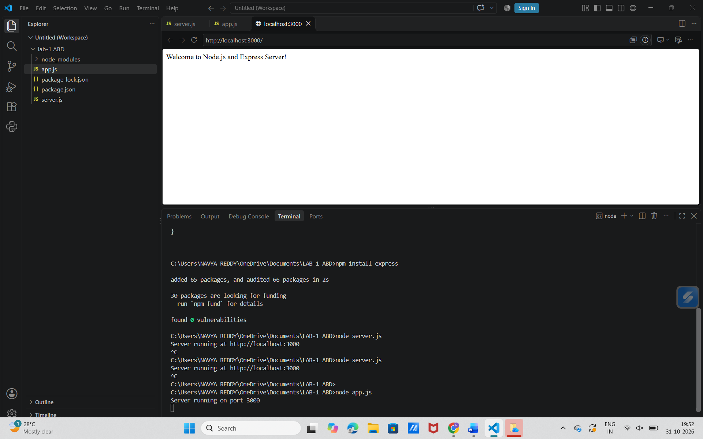
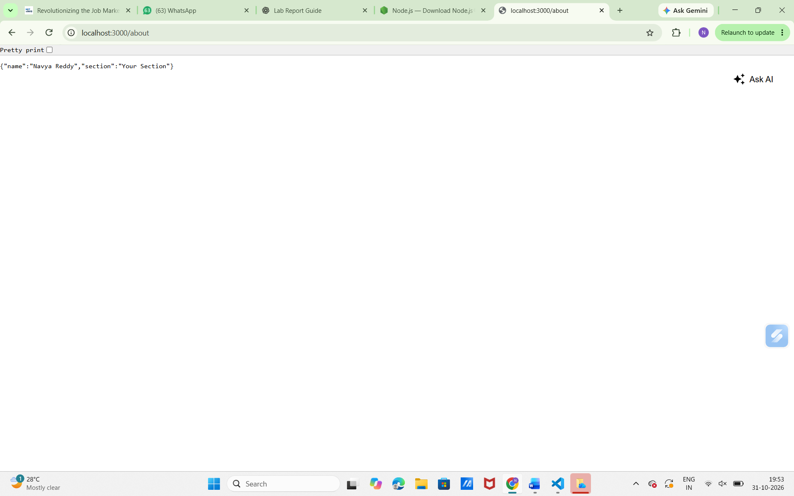
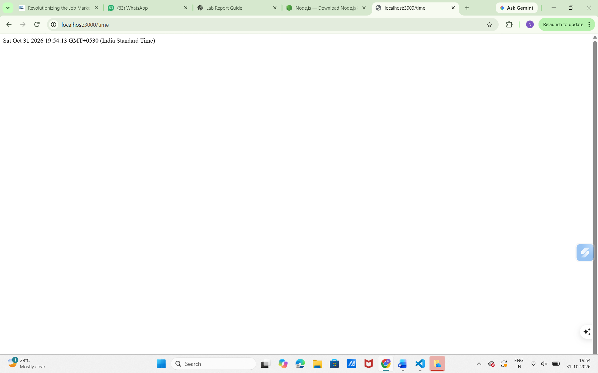

# Lab 1: Node.js and Express Server

## Student Details

**Name:** Navya Reddy

**Registration Number:** 252U1R1203

**Section:** CSE-2D

## Deployment Link

Enter your public deployment URL here after deployment.

## Aim

To create a basic HTTP server using Node.js and develop a web server using Express.js.

## Introduction

Node.js is a JavaScript runtime environment used to execute JavaScript outside the browser.

Express.js is a web framework used to create web applications and APIs easily.

## Software Requirements

- Node.js
- Visual Studio Code
- Express.js
- Google Chrome
- GitHub

## Installation Steps

1. Install Node.js.
2. Open the project folder in VS Code.
3. Open the terminal.
4. Install the required packages:

```bash
npm install
```

## Execution Steps

Run the application using:

```bash
node app.js
```

Open the browser and enter:

```text
http://localhost:3000/
```

## API Endpoints

| Method | Endpoint | Description |
|---|---|---|
| GET | / | Home page |
| GET | /about | Student details |
| GET | /time | Current date and time |
| GET | /hello | Test 404 error |

Note: These endpoints must match the routes implemented in your app.js file.

## Screenshots

### 1. Home Page



### 2. About Page



### 3. Time Page



### 4. Error 404 Page


## Conclusion

Successfully created and executed a Node.js and Express.js server. Tested the application using different HTTP endpoints.

## GitHub Repository
## Deployment

**Platform:** Render

**Deployed Link:**  https://navya-reddy-1.onrender.com

**Status:** Successfully Deployed

## Output Screenshots

- Home Page
- About Page
- Time Page
- Error Page
